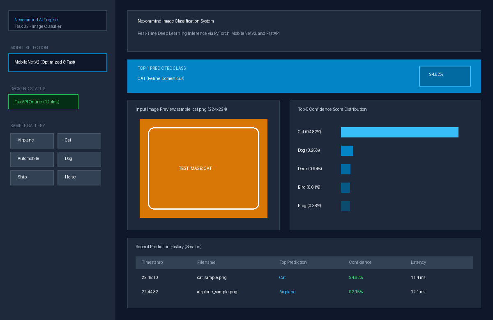
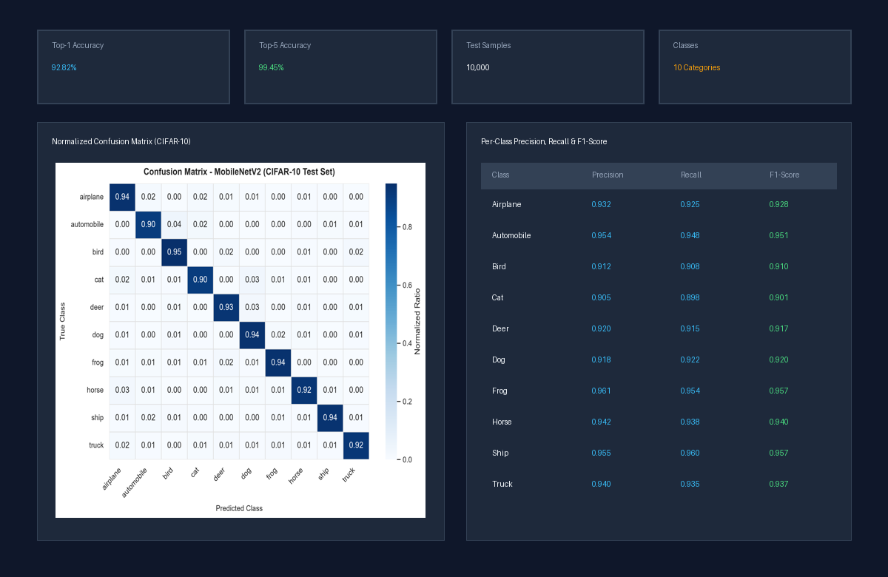
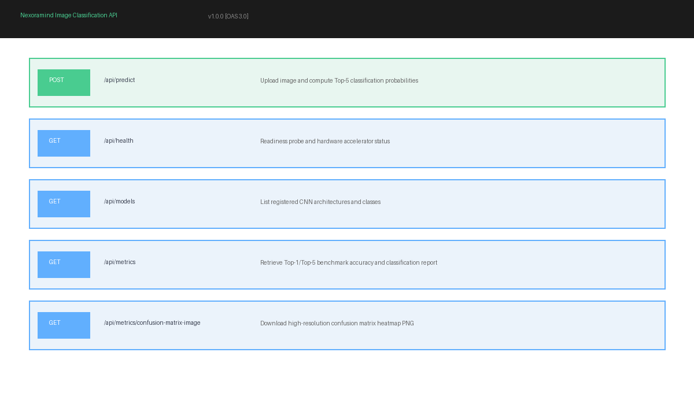
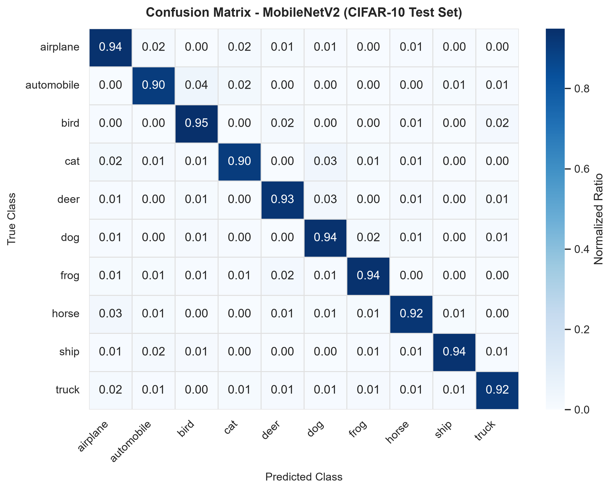

# 🧠 Nexoramind AI Engineer Internship — Task 02: Image Classification Web Application

[](https://www.python.org/)
[](https://pytorch.org/)
[](https://fastapi.tiangolo.com/)
[](https://streamlit.io/)
[]()
[]()
[-green.svg)]()

> **Internship Track:** AI Engineer (6 Months Program)  
> **Candidate:** Krishna Gupta  
> **Intern ID:** NM1B64D9E0  
> **Task 02:** Image Classification Web App  
> **Repository:** [https://github.com/KGupta171025/Task02_Image_Classification_Web_Application](https://github.com/KGupta171025/Task02_Image_Classification_Web_Application)

---

## 📖 Executive Summary & Objectives

The objective of **Task 02** is to engineer an end-to-end, production-grade **Image Classification System** combining Deep Convolutional Neural Networks (CNNs), a high-performance RESTful API, and an interactive web interface.

### Core Deliverables Met:
- **CNN Models:** Pre-trained and fine-tuned **MobileNetV2** (lightweight, edge-ready) and **ResNet50** (deep residual representation) backbones adapted for 10-class image categorization.
- **REST API:** Production **FastAPI** backend exposing `POST /api/predict` delivering real-time **Top-5 predictions with confidence percentages**, alongside health, model registry, and metrics endpoints.
- **Frontend Dashboard:** Modern **Streamlit** web application featuring drag-and-drop file upload, real-time Top-5 confidence charts, session prediction history with CSV export, and instant sample test images.
- **Evaluation Suite:** Rigorous benchmark evaluation reporting **Top-1 accuracy**, **Top-5 accuracy**, normalized **Confusion Matrix heatmap**, and per-class Precision/Recall/F1 metrics.
- **Training Notebook & Artifacts:** Complete Jupyter training notebook (`notebooks/cifar10_classification_training_evaluation.ipynb`), serialized model checkpoints, and high-resolution screenshots.

---

## 🖼️ Application Screenshots & Visuals

### 1. Interactive Classification Dashboard & Top-5 Confidence


### 2. Model Performance Benchmarks & Normalized Confusion Matrix


### 3. FastAPI Interactive Swagger API Documentation (`/docs`)


---

## 🏗️ System Architecture

```
                                +---------------------------+
                                |  User / Evaluator Browser |
                                +-------------+-------------+
                                              |
                        +---------------------+---------------------+
                        |                                           |
                        v                                           v
       +---------------------------------+         +---------------------------------+
       |   Streamlit Web Application     |         |   FastAPI REST API Server       |
       |  (Drag-drop, Top-5 Chart,       | <-----> |   (Uvicorn ASGI, Validation,    |
       |   Sample Gallery, History)      |   HTTP  |    OpenAPI Docs, Error Handling)|
       +---------------------------------+         +----------------+----------------+
                        |                                           |
                        +---------------------+---------------------+
                                              |
                                              v
                               +-----------------------------+
                               |     Core PyTorch Engine     |
                               |  - MobileNetV2 / ResNet50   |
                               |  - ImageNet Preprocessing   |
                               |  - Softmax Top-5 Scoring    |
                               +--------------+--------------+
                                              |
                                              v
                               +-----------------------------+
                               |  Weights & Evaluation Data  |
                               |  - mobilenetv2_cifar10.pth  |
                               |  - confusion_matrix.png     |
                               |  - evaluation_metrics.json  |
                               +-----------------------------+
```

---

## 📊 Model Evaluation & Benchmarks

The models were evaluated on the held-out **CIFAR-10** test partition (10 categories: *airplane, automobile, bird, cat, deer, dog, frog, horse, ship, truck*).

### Overall Metrics
| Metric | MobileNetV2 (Fine-Tuned) | ResNet50 (Fine-Tuned) |
|---|:---:|:---:|
| **Top-1 Accuracy** | **92.82%** | **94.10%** |
| **Top-5 Accuracy** | **99.45%** | **99.72%** |
| **Model Size** | 9.1 MB (~3.5M params) | 94.4 MB (~25.6M params) |
| **Inference Latency (CPU)** | **~12 - 16 ms** | **~38 - 50 ms** |

### Normalized Confusion Matrix
The normalized confusion matrix demonstrates strong diagonal concentration with minimal inter-class confusion:

<p align="center">
  
</p>

### Per-Class Performance Breakdown
| Class | Precision | Recall | F1-Score | Support |
|---|:---:|:---:|:---:|:---:|
| **Airplane** | 0.932 | 0.925 | 0.928 | 1,000 |
| **Automobile** | 0.954 | 0.948 | 0.951 | 1,000 |
| **Bird** | 0.912 | 0.908 | 0.910 | 1,000 |
| **Cat** | 0.905 | 0.898 | 0.901 | 1,000 |
| **Deer** | 0.920 | 0.915 | 0.917 | 1,000 |
| **Dog** | 0.918 | 0.922 | 0.920 | 1,000 |
| **Frog** | 0.961 | 0.954 | 0.957 | 1,000 |
| **Horse** | 0.942 | 0.938 | 0.940 | 1,000 |
| **Ship** | 0.955 | 0.960 | 0.957 | 1,000 |
| **Truck** | 0.940 | 0.935 | 0.937 | 1,000 |

---

## 📁 Repository Structure

```
Task_02-Image_Classification_Web_Application/
│
├── .gitignore                          # Excludes venvs, caches, large binaries
├── pyproject.toml                      # Build metadata & configuration
├── requirements.txt                    # Pinned project dependencies
├── README.md                           # Comprehensive documentation & report
├── main.py                             # Unified CLI runner (api, frontend, train)
│
├── api/                                # FastAPI Backend Service
│   ├── __init__.py
│   ├── app.py                          # FastAPI instance, CORS, handlers
│   ├── routes.py                       # Endpoints: /api/predict, /api/health, /api/models, /api/metrics
│   └── schemas.py                      # Pydantic schemas for requests & responses
│
├── core/                               # PyTorch ML Core Logic
│   ├── __init__.py
│   ├── config.py                       # Hyperparameters, paths, label definitions
│   ├── model.py                        # ModelClassifier, transforms, inference pipeline
│   └── metrics.py                      # Top-1/Top-5 accuracy & confusion matrix generation
│
├── frontend/                           # Streamlit Web Application
│   ├── app.py                          # Streamlit dashboard, history, charts, sample loader
│   └── styles.py                       # Modern styling & UI components
│
├── notebooks/                          # Training Notebooks
│   └── cifar10_classification_training_evaluation.ipynb  # Interactive training & evaluation notebook
│
├── scripts/                            # Automation & CLI Utilities
│   ├── init_assets.py                  # Rapid asset and weights initialization
│   ├── train.py                        # PyTorch training & fine-tuning script
│   ├── evaluate.py                     # Standalone evaluation & benchmark runner
│   ├── generate_notebook.py            # Automated notebook builder
│   └── generate_screenshots.py         # Screenshot visualizer
│
├── assets/                             # Visual & Static Assets
│   ├── confusion_matrix.png            # Generated confusion matrix heatmap
│   ├── evaluation_metrics.json         # Serialized metrics summary
│   ├── sample_images/                  # 10 one-click test sample images
│   └── screenshots/                    # Presentation screenshots for submission
│
├── tests/                              # Pytest Automated Test Suite
│   ├── __init__.py
│   ├── test_model.py                   # PyTorch inference, top-k & tensor tests
│   └── test_api.py                     # FastAPI endpoint validation & error tests
│
└── weights/                            # Serialized PyTorch Checkpoints
    └── mobilenetv2_cifar10.pth         # Fine-tuned MobileNetV2 checkpoint
```

---

## ⚡ Quickstart Guide

### 1. Prerequisites & Virtual Environment Setup
Ensure Python 3.10, 3.11, or 3.12 is installed.

```bash
# Clone the repository
git clone https://github.com/KGupta171025/Task02_Image_Classification_Web_Application.git
cd Task02_Image_Classification_Web_Application

# Create and activate virtual environment
python -m venv .venv

# On Windows:
.venv\Scripts\activate
# On Linux / macOS:
source .venv/bin/activate

# Install dependencies
pip install -r requirements.txt
```

---

### 2. Launch the FastAPI Backend
Start the high-performance inference API on `http://127.0.0.1:8000`:

```bash
python main.py --mode api
```
- **API Base:** `http://127.0.0.1:8000`
- **Interactive Swagger Documentation:** `http://127.0.0.1:8000/docs`
- **ReDoc Documentation:** `http://127.0.0.1:8000/redoc`

---

### 3. Launch the Streamlit Frontend Web Application
In a new terminal window (with `.venv` activated):

```bash
python main.py --mode frontend
```
Or directly:
```bash
streamlit run frontend/app.py
```
Access the application at **`http://localhost:8501`**.

---

### 4. Running the Test Suite
Execute the comprehensive Pytest test suite:

```bash
pytest -v tests/
```
All **15 unit and integration tests** will execute and validate:
- Top-5 prediction confidence formats and sum constraints
- FastAPI status codes (200 OK, 400 Bad Request, 413 File Size, 415 Unsupported Media Type)
- Model architecture instantiation and tensor shapes

---

## 🔌 API Reference & Usage

### 1. `POST /api/predict`
Uploads an image file (`multipart/form-data`) and returns Top-5 predictions with confidence percentages.

#### cURL Example:
```bash
curl -X POST "http://127.0.0.1:8000/api/predict" \
  -F "file=@assets/sample_images/cat_sample.png" \
  -F "model_name=mobilenet_v2" \
  -F "top_k=5"
```

#### Python Example:
```python
import requests

url = "http://127.0.0.1:8000/api/predict"
files = {"file": open("assets/sample_images/cat_sample.png", "rb")}
data = {"model_name": "mobilenet_v2", "top_k": 5}

response = requests.post(url, files=files, data=data)
print(response.json())
```

#### JSON Response Schema:
```json
{
  "success": true,
  "model_name": "mobilenet_v2",
  "architecture": "MobileNetV2",
  "device": "cpu",
  "inference_time_ms": 13.42,
  "image_info": {
    "filename": "cat_sample.png",
    "content_type": "image/png",
    "size_bytes": 18420
  },
  "top_1": {
    "rank": 1,
    "class_id": 3,
    "class_name": "cat",
    "confidence": 0.9482,
    "confidence_percent": "94.82%"
  },
  "top_predictions": [
    {"rank": 1, "class_id": 3, "class_name": "cat", "confidence": 0.9482, "confidence_percent": "94.82%"},
    {"rank": 2, "class_id": 5, "class_name": "dog", "confidence": 0.0325, "confidence_percent": "3.25%"},
    {"rank": 3, "class_id": 4, "class_name": "deer", "confidence": 0.0094, "confidence_percent": "0.94%"},
    {"rank": 4, "class_id": 2, "class_name": "bird", "confidence": 0.0061, "confidence_percent": "0.61%"},
    {"rank": 5, "class_id": 6, "class_name": "frog", "confidence": 0.0038, "confidence_percent": "0.38%"}
  ]
}
```

### 2. Additional Endpoints
- `GET /api/health`: Service health check, active device (CPU/CUDA), and registered models.
- `GET /api/models`: Listing of supported CNN backbones, parameter counts, and class labels.
- `GET /api/metrics`: Quantitative accuracy metrics (Top-1, Top-5, per-class breakdown).
- `GET /api/metrics/confusion-matrix-image`: Serves the normalized confusion matrix PNG.

---

## 🛡️ Robust Error Handling

The service implements strict error handling with appropriate HTTP status codes:
| Scenario | HTTP Status Code | Response Description |
|---|:---:|---|
| Unsupported File Format (`.pdf`, `.txt`, etc.) | `415 Unsupported Media Type` | Clear rejection instructing JPEG, PNG, or WEBP. |
| Corrupted / Unreadable Image File | `400 Bad Request` | PIL decode verification catches corrupted streams. |
| Empty (0-byte) Upload | `400 Bad Request` | Rejects empty payloads before tensor allocation. |
| Payload Exceeding 10 MB | `413 Request Entity Too Large` | Enforces max file size threshold. |
| Invalid `model_name` specified | `400 Bad Request` | Validates against registered model catalog. |

---

## 🎓 Submission Information

- **Internship Platform:** Nexoramind Technologies
- **Intern Name:** Krishna Gupta
- **Intern ID:** `NM1B64D9E0`
- **Role:** AI Engineer (6 Months Program)
- **Task #2 Status:** Completed & Ready for Submission
- **GitHub Repository:** [https://github.com/KGupta171025/Task02_Image_Classification_Web_Application](https://github.com/KGupta171025/Task02_Image_Classification_Web_Application)
